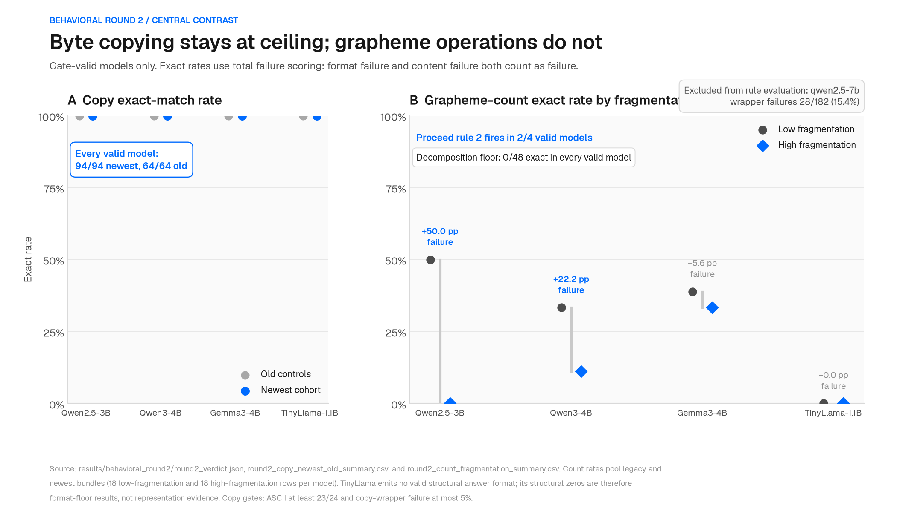
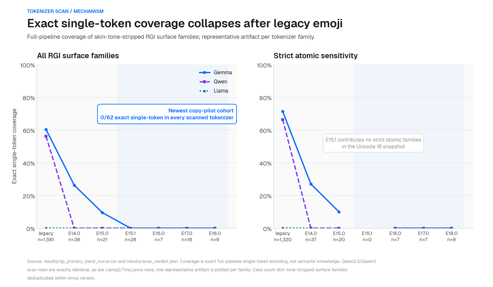
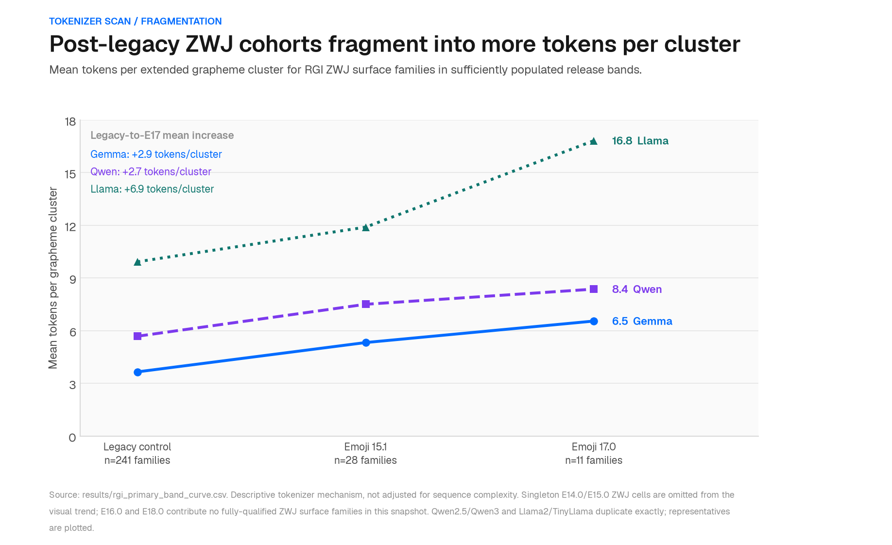
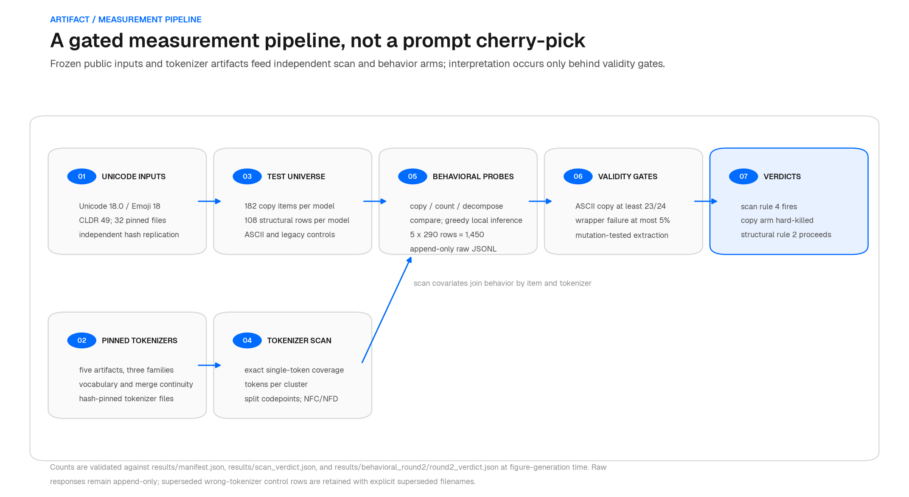

# Unicode release debt

**Headline result:** in this controlled local pilot, gate-valid instruction-tuned models copied even the newest Unicode items byte-perfectly while often failing to count or decompose the same grapheme clusters; the measurable release-debt signal is structural understanding, not byte copying.

This repository is a reproducible research artifact for measuring whether Unicode/emoji release recency affects tokenizer representation and model behavior. It combines a pinned Unicode-data tokenizer scan with a strict byte-level behavioral experiment. It is a pilot-stage artifact, not a benchmark leaderboard and not a claim about frontier-scale models.



The central contrast is visible above: the operational copy arm is at ceiling, while count-probe accuracy degrades in high-fragmentation items. Both panels use only gate-valid models.

## Results at a glance

### Tokenizer scan

Unicode inputs are pinned to Unicode 18.0.0, Emoji 18, and CLDR release-49. Five tokenizer artifacts are scanned. Thirty-two input files are SHA-256 pinned. The grapheme segmenter passes 853/853 official UAX #29 conformance tests; a split-every-codepoint negative control fails 516 tests, demonstrating that the conformance check can fail.

| Tokenizer family | Legacy pooled exact single-token coverage | E15.1+ coverage | Legacy atomic coverage | Interpretation |
|---|---:|---:|---:|---|
| Gemma mirror | 0.603 (n=1561) | 0.000 | 0.714 (n=1320) | large release-coverage collapse |
| Qwen2.5/Qwen3 | 0.561 (n=1561) | 0.000 | 0.664 (n=1320) | large release-coverage collapse |
| Llama2/TinyLlama | 0.002 (n=1561) | 0.000 | 0.002 (n=1320) | near floor already; ceiling-sensitive, not primary evidence |

- In every scanned tokenizer, **0/62 newest-cohort emoji** are exact single-token items through either the full tokenizer pipeline or exact vocabulary-entry lookup.
- Scan proceed-rule 4 fires in Gemma, Llama, and Qwen under the prespecified non-increasing/non-decreasing interpretation. Gemma and Qwen independently satisfy the two-family threshold even if near-floor Llama is discounted.
- Absence of exact tokens is not proof of model ignorance: byte fallback can still represent the sequences. That distinction motivates the behavioral arm.





### Behavioral round 2

Round 2 contains **1,450 completed rows**: five models times 290 probes per model. Each model received 182 copy probes and 108 structural probes. Four models passed the harness-validity gates:

- `qwen2.5-3b-instruct-bf16`
- `qwen3-4b-instruct-2507-mlx8`
- `gemma3-4b-it-mlx8-mirror`
- `tinyllama-1.1b-chat-v1.0-bf16`

`qwen2.5-7b-instruct-mlx8` failed the wrapper gate (28/182 copy rows, 15.4%) and is excluded from every proceed/hard-kill rule.

| Measure | Result in gate-valid models |
|---|---|
| Newest-cohort copy | **94/94 byte-exact in each valid model** |
| Legacy copy controls | **64/64 byte-exact in each valid model** |
| Missing-ZWJ errors | 0 |
| Missing-VS16 errors | 0 |
| Normalization-only copy mismatches | 0 |
| Newest decomposition | **0/24 exact in every model**, newest and legacy eras alike |
| Proceed-rule 2 count fragmentation signal | qwen2.5-3b: +50.0 pp high-minus-low failure gap; qwen3-4b: +22.2 pp |
| Final behavioral interpretation | **proceed** |
| Operational copy arm | **hard-killed** |
| Whole project | not hard-killed, because scan rule 4 and structural rule 2 fire |

The decomposition result is an era-independent floor: 0/48 decomposition probes exact in every model across both eras. It should not be read as a newest-release-specific decomposition effect. The count probe carries the fragmentation contrast.

TinyLlama passes the copy and wrapper gates but has 100% format failure on structural probes. It is therefore useful as a vintage-tokenizer copy carrier, but its structural content cannot be interpreted beyond format compliance.

### The wrapper-mimicry cautionary tale

The invalid `qwen2.5-7b-instruct-mlx8` initially appears to show a 20.3 pp newest-minus-old copy failure gap. Post-hoc byte forensics show that all 28 of its wrapper failures are `<IN>`-tag mimicry: the model emits the target inside the wrong-direction wrapper, and **28/28 inner copies are byte-perfect** with zero byte difference. The failures are concentrated in emoji cohorts (E15.1=7, E16=3, E17=9, E18=6, legacy emoji=3) and absent from ASCII and non-emoji controls.

That apparent copy gap is therefore not evidence of byte-copy release debt. It is a format-direction failure, the model is gate-invalid, and the rows are excluded from inferential rules. This is why the artifact treats wrapper validity as a measurement gate rather than silently relabeling or repairing outputs.

## Measurement design



1. **Pinned inputs.** Download Unicode, emoji, CLDR, grapheme-test, and tokenizer artifacts; hash every input.
2. **Tokenizer scan.** Measure exact vocabulary membership, full-pipeline token counts, byte fallback, split codepoints, NFC/NFD behavior, and round-trip fidelity without loading model weights.
3. **Behavioral probes.** Probe item identities are frozen before inference. Copy prompts use the frozen `fewshot_copy_v5_multiturn_cueless` protocol; extraction requires exactly one `<OUT>...</OUT>` pair and performs no stripping, normalization, or repair.
4. **Validity gates.** ASCII copy controls, wrapper-format rates, mutation checks, completeness, tokenizer linkage, quantization sensitivity, and template rendering are checked before interpretation.
5. **Analysis.** Copy exactness is byte equality. Structural probes measure decomposition, grapheme counting, and comparison. Machine verdicts implement the proceed/hard-kill rules rather than relying on narrative selection.

Quantization control: Qwen2.5-1.5B ASCII exact was **23/24 bf16 versus 23/24 MLX 8-bit**, within the prespecified noise envelope. This supports, but does not prove generalizable, use of MLX 8-bit artifacts for larger models.

## Reproduce the artifact

Requirements:

- Python 3.12 (the recorded host used Python 3.12.13)
- network access on first run for pinned Unicode/Hugging Face inputs
- macOS/Apple Silicon for the pinned MLX dependency set and for any new inference
- enough disk for downloaded inputs and tokenizer/model artifacts; generated `data/` is intentionally gitignored

One command:

```sh
./reproduce.sh
```

or:

```sh
make reproduce
```

This command:

1. creates `.venv` if needed and installs pinned dependencies;
2. downloads/rebuilds and hash-checks the scan inputs;
3. reruns the tokenizer scan and scan analysis;
4. regenerates behavioral probe plans;
5. rescores the committed append-only round-2 raw responses;
6. regenerates wrapper-mimicry and round-2 analyses;
7. regenerates all figures; and
8. runs `src/check_artifact.py`, which fails closed if core gates, counts, verdicts, input hashes, or figure hashes change.

The final output should include `"artifact_check": "pass"`.

### What reproduction does and does not mean

`./reproduce.sh` reproduces the measurement pipeline from pinned inputs and committed raw model responses. It does **not** rerun model inference. Repeating inference requires downloading model weights, Apple Silicon MLX runtime support, and careful adherence to the freeze/calibration order documented in `results/ROUND2_REPORT.md`. The per-model runner is `src/run_behavioral_round2.py`; example shape:

```sh
.venv/bin/python src/run_behavioral_round2.py \
  --model qwen2.5-3b-instruct-bf16 \
  --copy-protocol fewshot_copy_v5_multiturn_cueless
```

Do not use that example as a substitute for the full round-2 protocol. The protocol order matters: quantization sensitivity first, protocol calibration and freeze before cohort inference, then append-only cohort generation.

Generated scan/analysis timestamps may change on a fresh verification run. Scientific rows, gates, verdicts, input hashes, and figure output hashes are the invariant targets checked by `check_artifact.py`.

## Repository layout

```text
docs/
  SPEC.md                  frozen research specification
  EXTRACTIONS.md           literature/novelty extraction notes
  figures/                 generated PNG/SVG figures and figure manifest
  assets/fonts/            Geist font files and OFL license used in figures
src/
  ucd_build.py             pinned Unicode input acquisition/build
  tokscan.py               tokenizer inventory and scan
  testset.py               probe/test-set construction
  validate.py              input and conformance validation
  analyze_scan.py          scan report and machine verdict
  behavioral_probes.py     behavioral probe generation
  run_behavioral_round2.py append-only MLX inference runner
  score_behavioral_round2.py strict extraction/scoring and mutation battery
  analyze_wrapper_mimicry.py post-hoc wrapper-direction byte forensics
  analyze_behavioral_round2.py round-2 report and machine verdict
  make_figures.py          deterministic figure generation
  check_artifact.py        fail-closed artifact verification
results/
  SCAN_REPORT.md           tokenizer-scan report
  ROUND2_REPORT.md         behavioral round-2 report
  PILOT_REPORT.md          historical round-1 report
  behavioral_round2/       raw responses, scored rows, gates, verdicts, manifests
  *.jsonl / *.csv / *.json scan inputs, outputs, summaries, and audits
run.sh                     scan pipeline only
reproduce.sh               end-to-end non-inference artifact verification
Makefile                   convenience targets
requirements.txt           pinned Python dependencies
```

`data/` is intentionally not committed. It contains large downloaded Unicode/Hugging Face inputs. Input URLs, versions, paths, sizes, and SHA-256 hashes are recorded in `results/manifest.json` and `src/pinned_inputs.json`; the pipeline verifies them before use.

## Artifact integrity

- Thirty-two scan input files are SHA-256 pinned and independently re-downloaded/hash-checked.
- Probe item identity, prompt templates, model revisions, tokenizer linkage, raw responses, scored rows, and analysis artifacts are hash-manifested.
- Extraction mutation checks verify that byte substitutions, missing ZWJ, missing VS16, newline padding, NFC/NFD mutations, missing/duplicate wrappers, echoed prompts, prefix/suffix text, and truncations are rejected or classified as intended.
- Figure generation is deterministic and validated against `docs/figures/figure_manifest.json`.
- The artifact checker was designed to fail closed: missing files, hash mismatches, changed verdicts, or mutated gate outcomes stop verification.
- Round-1 results remain in the repository as historical artifacts. Round 2 is the valid behavioral evidence because the round-1 copy instrument failed its own validity gate.

## Honest limitations

- **Pilot scale:** small local instruction-tuned models only; no frontier-scale or hosted-model inference.
- **Item counts:** newest emoji cohorts are small by nature (E16=7, E17=18, E18=9 in the copy test), so cohort contrasts are sensitive to item composition.
- **ZWJ/atomic confounding:** release cohorts differ in sequence composition. The scan reports atomic-only sensitivity series for this reason.
- **Copy ceiling:** byte copying is a lower-level skill and may fail only in larger/different settings; this artifact shows that release recency did not measurably impair it here.
- **Structural prompting:** structural probes are format-sensitive. TinyLlama's structural result is dominated by format failure and is not evidence about internal representation.
- **MLX conversion provenance:** pinned MLX artifacts are the inference identity, but weight-hash equivalence to canonical upstream weights cannot be independently verified for converted artifacts.
- **Platform specificity:** behavioral inference and the pinned full dependency set target macOS/Apple Silicon MLX.
- **Tokenizer/model granularity:** scan tokenizers are linked to behavioral models by explicit artifact comparison; strict byte identity and scan-covariate usability are reported separately rather than conflated.
- **No causal embedding claim:** vocabulary absence and fragmentation are measured representation properties. The artifact does not claim to identify the internal attention mechanism beyond the behavioral dissociation.

## Status and next steps

Current status: reproducible pilot artifact. The next scientifically useful steps are prespecified confirmatory replication with a larger item battery, more model families and sizes, controlled fragmentation matched within release era, and a hosted-model supplement only where token/logprob exposure supports byte-level attribution. Any confirmatory round should freeze instruments before inference and preserve append-only raw outputs.

## Positioning and related work

The closest prior work is adjacent but does not occupy this exact intersection: byte-exact copying or grapheme-structure behavior stratified by Unicode/emoji release version and tokenizer vintage. See `docs/EXTRACTIONS.md` for the full extraction notes. Key positioning references:

- Jang et al., *Improbable Bigrams*, EMNLP 2025, arXiv:2410.23684: incomplete-token bigrams cause substantial exact-copy failure.
- Moon et al., *ByteCanary*, ICML 2026, arXiv:2606.14122: strict UTF-8 validity lags partial validity across public LLMs.
- Zhang et al., *When Copying Is Hard*, NeurIPS 2026, arXiv:2610.28393: even ordinary verbatim copying is brittle in base LLMs.
- Land and Bartolo, *Fishing for Magikarp*, EMNLP 2024: manually added emoji tokens can be unreachable or untrained.
- UBE, NeurIPS 2026, arXiv:2610.01984: codec-only Unicode audit, contrasted here with LLM behavior.
- Zhou et al., NLP+CSS 2026: post-cutoff emoji OOV affects semantic classification, a temporal-release precedent but not byte copying.

A final pre-submission literature pass should recheck these citations and the watch terms listed in `docs/EXTRACTIONS.md`.

## Citation

If you use this artifact, cite the repository and the report files directly until a paper/preprint exists. A machine-readable scaffold is provided in `CITATION.cff`.

Suggested interim citation:

```text
Sapalidis, Nikolas. Unicode release debt: reproducible tokenizer-scan and behavioral pilot artifact. 2026. https://github.com/nikolas-sapa/unicode-release-debt
```

## License

Unless otherwise noted, this repository is released under the Creative Commons Attribution 4.0 International License. See `LICENSE`. The Geist font files in `docs/assets/fonts/` are distributed under their own SIL Open Font License 1.1 text in `docs/assets/fonts/OFL.txt`.
